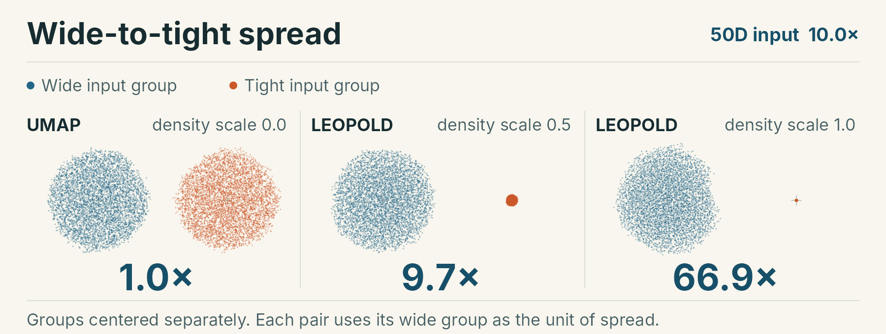

I think about dimensionality reduction a lot. I wrote and maintain [uwot], an implementation of UMAP
in R and C++. If you've made a UMAP plot of single-cell data with [Seurat][seurat], you've probably
used it.

If you're coming to UMAP from t-SNE, I [wrote up how the two are related][umap-for-tsne]. I got
the details from the Python code and from asking Leland McInnes. Much of that material ended up in
the implementation appendix of the [UMAP paper][paper].

### Where did the density go?

I gave UMAP two groups of 5,000 points each. In the original 50 dimensions the blue group has ten
times the standard deviation of the orange one. Here's what happens when I turn up the density
scaling in [Leopold][leopold], my approximation to densMAP in `uwot`.

<a href="https://jlmelville.github.io/jlmelville/#experiment-title">
  <picture>
    <source media="(max-width: 700px)" srcset="images/leopold-spread-mobile.png">
    
  </picture>
</a>

Ordinary UMAP gives the two groups about the same amount of room. Halfway up the scale I get most
of my tenfold difference back. Turn it all the way up and that little orange dot still contains
5,000 points.

[Try all eleven settings on my homepage][leopold-live] or [download the offline figure
(ZIP)][leopold-figure]. The [original experiments][leopold] include handwritten digits and
single-cell data too.

### Software

- Two of my R packages can find nearest neighbors for `uwot`. [rnndescent] implements nearest
  neighbor descent and works with sparse data. [RcppHNSW] is my R interface to `hnswlib`.
- I use [smallvis] to change one thing at a time, e.g. hold the starting positions fixed and see
  what changing the cost function does. For larger 2D embeddings, its C++ code can approximate the
  repulsive forces with FFT interpolation, a Barnes–Hut tree or a mutual tree. In Python I use
  [drnb] to try different methods on the same data and reuse the neighbors I've already calculated.
- [mize] is my R package for numerical optimization (you have to optimize those embeddings
  somehow). Its sibling [funconstrain] gives me 35 test problems from Moré, Garbow and Hillstrom
  to try the optimizers on.
- [revdeprunner] smooths out a few rough edges I hit getting my R packages ready for CRAN. It uses
  r-lib's [revdepcheck] to check the packages that depend on mine, and lets me see what needs
  building before I start. It's also my first entirely vibe-coded package.

### Selected writing

- [Jane Austen's nearest neighbors][austen]. I wanted an example of working with sparse data and
  ended up looking for the most Jane Austen-like passage in six novels.
- [Hubness and nearest neighbor search][hubness]. What happens to search accuracy when the same few
  points keep turning up in other points' neighbor lists?
- [Nesterov momentum][nesterov]. When I implemented it in `mize`, I wanted to check that the
  different versions gave the same results. That took a bit of working out.

### Current interests

How much can a Codex skill learn from the jobs I already use it for? I can't afford a big suite of
evals, so in [codex-workflows] I'm trying an idea borrowed from agile retrospectives. Some skills
help with jobs like [editing a vignette][technical-writing]. Others guide the agents as they look
back over a task, decide which observations warrant changing a skill, and check on later tasks
whether it helped.

More writing, notebooks and datasets

- [The cost functions and gradients of t-SNE, LargeVis and UMAP][theory], and a
  [derivation of neighbor-embedding gradients][gradients].
- [Estimating intrinsic dimensionality with Fisher information][perplexity] using quantities t-SNE
  already computes when calibrating perplexity.
- [Graph Laplacians, Laplacian eigenmaps and diffusion maps][spectral]. The [smallvis writing
  index][smallvis-docs] collects more experiments on initialization, perplexity and optimization.
- [Python notebooks on embedding and evaluation][notebooks], [notebooks for downloading and
  preparing datasets][datasets], and [snedata] for example datasets in R.
- An [older bibliography of dimensionality reduction papers][bibliography].

[uwot]: https://github.com/jlmelville/uwot
[seurat]: https://satijalab.org/seurat/reference/runumap
[umap-for-tsne]: https://jlmelville.github.io/uwot/articles/umap-for-tsne.html
[paper]: https://arxiv.org/abs/1802.03426
[leopold-live]: https://jlmelville.github.io/jlmelville/#experiment-title
[leopold-figure]: docs/leopold.zip?raw=true
[leopold]: https://jlmelville.github.io/uwot/articles/leopold.html
[rnndescent]: https://github.com/jlmelville/rnndescent
[RcppHNSW]: https://github.com/jlmelville/rcpphnsw
[austen]: https://jlmelville.github.io/rnndescent/articles/sparse-example.html
[hubness]: https://jlmelville.github.io/rnndescent/articles/hubness.html
[smallvis]: https://github.com/jlmelville/smallvis
[drnb]: https://github.com/jlmelville/drnb
[mize]: https://github.com/jlmelville/mize
[funconstrain]: https://github.com/jlmelville/funconstrain
[nesterov]: https://jlmelville.github.io/mize/articles/nesterov.html
[revdeprunner]: https://github.com/jlmelville/revdeprunner
[revdepcheck]: https://github.com/r-lib/revdepcheck
[codex-workflows]: https://github.com/jlmelville/codex-workflows
[technical-writing]: https://github.com/jlmelville/codex-workflows/tree/main/skills/technical-writing
[theory]: https://jlmelville.github.io/smallvis/theory.html
[gradients]: https://jlmelville.github.io/sneer/gradients.html
[perplexity]: https://jlmelville.github.io/smallvis/idp-theory.html
[spectral]: https://jlmelville.github.io/smallvis/spectral.html
[smallvis-docs]: https://jlmelville.github.io/smallvis/
[notebooks]: https://github.com/jlmelville/drnb/tree/master/notebooks
[datasets]: https://github.com/jlmelville/drnb/tree/master/notebooks/data-pipeline
[snedata]: https://github.com/jlmelville/snedata
[bibliography]: https://jlmelville.github.io/sneer/references.html
