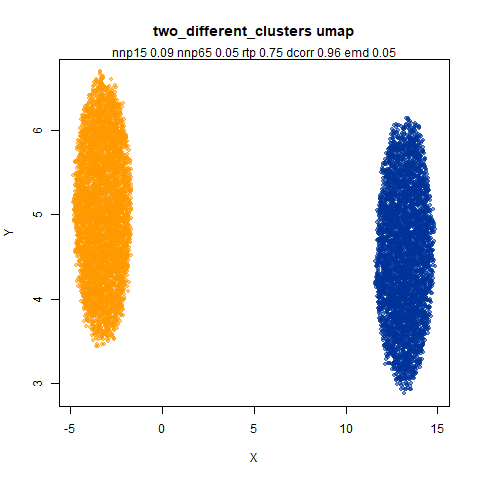
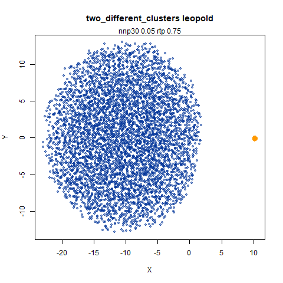

I think about dimensionality reduction a lot. I wrote and maintain [uwot], an implementation of UMAP
in R and C++. If you've made a UMAP plot of single-cell data with [Seurat][seurat], you've probably
used it.

If you're coming to UMAP from t-SNE, I [wrote up how the two are related][umap-for-tsne]. I got
the details from the Python code and from asking Leland McInnes. Much of that material ended up in
the implementation appendix of the [UMAP paper][paper]. That appendix was my main contribution as a
co-author.

### Can you tell which cluster is denser?

Here are two groups of 5,000 points each. In the original 50 dimensions, one group has ten times the
standard deviation of the other. See if you can tell which is which from the first plot.

[][leopold]
[][leopold]

The orange group is the denser one. UMAP gives the two groups about the same amount of room. For
the second plot I used [Leopold][leopold], my approximation to densMAP, which tries to preserve
differences in local density. It gets the sizes the right way round, although shrinking 5,000
points to a little orange dot is probably overdoing it. [I tried it on a few less artificial
datasets too][leopold], including handwritten digits and single-cell data.

### Software and experiments

- Two of my R packages can find nearest neighbors for `uwot`. [RcppHNSW] is an interface to
  `hnswlib`. [rnndescent] implements nearest neighbor descent and also works with sparse data. For
  an example, here's what happens if you go looking for [the most Jane Austen-like passage in Jane
  Austen][austen].
- I use [smallvis] for experiments where I want to change one thing at a time, e.g. keep the
  starting positions of the points fixed and see what changing the cost function does. For comparing
  lots of methods on the same data I use [drnb], a collection of Python notebooks and tools that
  lets me reuse the neighbors I've already calculated.
- [mize] is my R package for numerical optimization (you have to optimize those embeddings
  somehow). When I implemented Nesterov momentum I wanted to check that the different versions
  gave the same results. That took [a bit of working out][nesterov].
- If you maintain an R package, [revdeprunner] checks what happens to the packages that depend on
  yours when you change it. If there are a lot of them, you can pick up where you left off.

More writing, notebooks and datasets

- [The cost functions and gradients of t-SNE, LargeVis and UMAP][theory], and a
  [derivation of neighbor-embedding gradients][gradients].
- [Estimating intrinsic dimensionality with Fisher information][perplexity] using quantities t-SNE
  already computes when calibrating perplexity.
- [Graph Laplacians, Laplacian eigenmaps and diffusion maps][spectral]. The [smallvis writing
  index][smallvis-docs] collects more experiments on initialization, perplexity and optimization.
- [Python notebooks on embedding and evaluation][notebooks], [notebooks for downloading and
  preparing datasets][datasets], and [snedata] for example datasets in R.
- [Hubness and nearest neighbor search][hubness]. What happens to search accuracy when the same few
  points keep turning up in other points' neighbor lists?
- An [older bibliography of dimensionality reduction papers][bibliography].

[uwot]: https://github.com/jlmelville/uwot
[seurat]: https://satijalab.org/seurat/reference/runumap
[umap-for-tsne]: https://jlmelville.github.io/uwot/articles/umap-for-tsne.html
[paper]: https://arxiv.org/abs/1802.03426
[leopold]: https://jlmelville.github.io/uwot/articles/leopold.html
[rnndescent]: https://github.com/jlmelville/rnndescent
[RcppHNSW]: https://github.com/jlmelville/rcpphnsw
[austen]: https://jlmelville.github.io/rnndescent/articles/sparse-example.html
[hubness]: https://jlmelville.github.io/rnndescent/articles/hubness.html
[smallvis]: https://github.com/jlmelville/smallvis
[drnb]: https://github.com/jlmelville/drnb
[mize]: https://github.com/jlmelville/mize
[nesterov]: https://jlmelville.github.io/mize/articles/nesterov.html
[revdeprunner]: https://github.com/jlmelville/revdeprunner
[theory]: https://jlmelville.github.io/smallvis/theory.html
[gradients]: https://jlmelville.github.io/sneer/gradients.html
[perplexity]: https://jlmelville.github.io/smallvis/idp-theory.html
[spectral]: https://jlmelville.github.io/smallvis/spectral.html
[smallvis-docs]: https://jlmelville.github.io/smallvis/
[notebooks]: https://github.com/jlmelville/drnb/tree/master/notebooks
[datasets]: https://github.com/jlmelville/drnb/tree/master/notebooks/data-pipeline
[snedata]: https://github.com/jlmelville/snedata
[bibliography]: https://jlmelville.github.io/sneer/references.html
